<p align="center">
  <a href="https://www.oneschema.co/">
    
  </a>
</p>

<p align="center">
  <a href="https://docs.oneschema.co/docs/intro"><code>docs</code></a> ·
  <a href="https://docs.oneschema.co/reference/getting-started-with-your-api"><code>api</code></a> ·
  <a href="https://docs.oneschema.co/docs/mcp-server"><code>mcp</code></a> ·
  <a href="https://github.com/oneschema/sdk"><code>sdk</code></a> ·
  <a href="https://www.oneschema.co/security"><code>security</code></a>
</p>

<p align="center">
  <a href="https://www.npmjs.com/package/@oneschema/importer"></a>
  <a href="https://www.npmjs.com/package/@oneschema/react"></a>
  <a href="https://www.npmjs.com/package/@oneschema/vue"></a>
</p>

OneSchema lets your customers upload messy spreadsheets and files, then maps, validates, and cleans the data before it reaches your application. Embed the **Importer** in your product, or automate recurring file pipelines with **Multi FileFeeds**.

## `$ quickstart`

Install the SDK for your framework:

```sh
npm install @oneschema/importer   # plain JavaScript
npm install @oneschema/react      # React
npm install @oneschema/angular    # Angular
npm install @oneschema/vue        # Vue
```

Launch an import and receive the cleaned data:

```js
import oneschemaImporter from "@oneschema/importer"

const importer = oneschemaImporter({
  clientId: "YOUR_CLIENT_ID",
  templateKey: "YOUR_TEMPLATE_KEY",
  userJwt: "YOUR_USER_JWT",
  importConfig: { type: "local" },
  devMode: true,
})

importer.on("success", (result) => console.log(result.data))
importer.on("cancel", () => console.log("Import canceled"))

await importer.launch()
```

Next: [create a template](https://docs.oneschema.co/docs/getting-started), [sign user JWTs](https://docs.oneschema.co/docs/generating-jwts), and follow the [embedding guide](https://docs.oneschema.co/docs/quickstart-embedding-with-the-sdk) for React, Angular, or Vue.

## `$ ls packages/`

| Package | What it is |
| --- | --- |
| [`@oneschema/importer`](https://www.npmjs.com/package/@oneschema/importer) | Plain JavaScript library for embedding the Importer |
| [`@oneschema/react`](https://www.npmjs.com/package/@oneschema/react) | React component |
| [`@oneschema/angular`](https://www.npmjs.com/package/@oneschema/angular) | Angular module |
| [`@oneschema/vue`](https://www.npmjs.com/package/@oneschema/vue) | Vue plugin |
| [`@oneschema/filefeeds`](https://www.npmjs.com/package/@oneschema/filefeeds), [`@oneschema/filefeeds-react`](https://www.npmjs.com/package/@oneschema/filefeeds-react) | Legacy FileFeeds embeds (maintenance mode) |
| [`@oneschema/pdfium-wasm`](https://github.com/oneschema/pdfium-wasm) | PDFium compiled to WebAssembly as an ES module |

Source for the SDKs lives in [oneschema/sdk](https://github.com/oneschema/sdk). Issues and pull requests are welcome; see its [contributing guide](https://github.com/oneschema/sdk/blob/main/CONTRIBUTING.md).

## `$ curl api.oneschema.co`

- **REST API:** manage templates, workspaces, imports, and FileFeeds. [API reference](https://docs.oneschema.co/reference/getting-started-with-your-api)
- **Multi FileFeeds:** connect S3, SFTP, Azure, Google Cloud Storage, SharePoint, or Workday and run validated file pipelines. [Build your first Multi FileFeed](https://docs.oneschema.co/docs/build-your-first-multi-filefeed)
- **MCP server:** give Claude, Cursor, Codex, Windsurf, or Devin direct access to the API specs at `https://api.oneschema.co/mcp`. [Set it up](https://docs.oneschema.co/docs/mcp-server)

## `$ git remote -v`

We also maintain forks of open-source projects we depend on, such as [lance](https://github.com/oneschema/lance), [calamine](https://github.com/oneschema/calamine), [hyper](https://github.com/oneschema/hyper), [rocket](https://github.com/oneschema/rocket), and [deno](https://github.com/oneschema/deno).

## `$ man oneschema`

- Questions or bugs in an SDK: [open an issue](https://github.com/oneschema/sdk/issues)
- Security reports: see [oneschema.co/security](https://www.oneschema.co/security)
- Product and sales: [oneschema.co](https://www.oneschema.co/)
